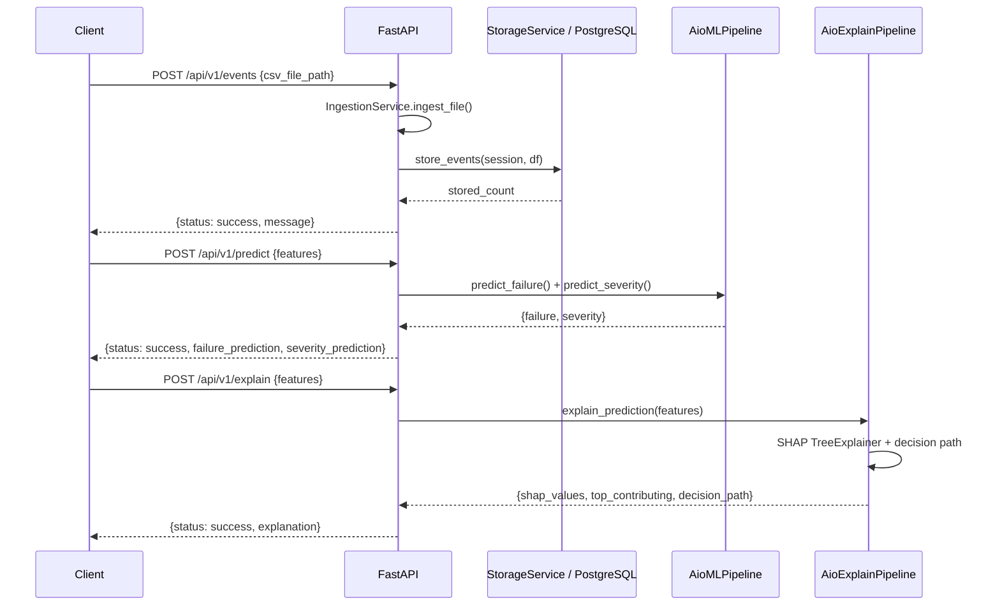

# LLD — AIOps Log Monitor (Low Level Design)

> Documento de diseño detallado: módulos, esquema DB, contrato API y flujos de operación. Acompaña a `ARCHITECTURE.md` (HLD).

## 1. Módulos y responsabilidades

| Módulo | Clase / Función | Responsabilidad |
|--------|----------------|-----------------|
| `src.api.main` | `app`, `/health`, `/events`, `/incidents`, `/predict`, `/explain`, `/models` | API REST; validación Pydantic; delega a servicios. |
| `src.ingestion.parse` | `IngestionConfig`, `EventParser`, `IngestionService` | Lectura y limpieza de CSV. |
| `src.ingestion.features` | `FeatureEngineer`, `FeaturePipeline`, `EventFeatures` | Features (temporal, severidad, riesgo). |
| `src.ml.train` | `AioMLPipeline` | RandomForest (fallo/severidad) + IsolationForest (anomalías). |
| `src.ml.explain` | `AioExplainPipeline` | SHAP TreeExplainer + recorrido de decisión. |
| `src.storage.db` | engine/session/init | Conexión SQLAlchemy. |
| `src.storage.init` | `StorageService` | `store_events`, `get_events`, `get_incidents`. |
| `src.storage.models` | `Event`, `Prediction` | ORM SQLAlchemy. |

## 2. Esquema físico de la base de datos

```sql
create table events (
  id serial primary key, received_at timestamptz not null default now(),
  environment varchar not null, project varchar not null, hostname varchar not null,
  instance_id varchar not null, event_type varchar not null, category varchar,
  severity varchar, status varchar, status_code float, duration_ms float,
  hour int, day_of_week varchar, method varchar, path varchar, line float,
  logger_name varchar, level varchar, risk_score float, is_weekend boolean,
  severity_level int, status_failure boolean, log_duration float,
  status_code_is_error boolean, schema_version varchar, sdk_version varchar,
  app_version varchar, trace_id varchar, message text
);
create index idx_events_environment on events(environment);
create index idx_events_severity on events(severity);
create index idx_events_status on events(status);
create index idx_events_received at events(received_at);
create index idx_events_hour on events(hour);

create table predictions (
  id serial primary key, event_id int not null references events(id) on delete cascade,
  failure_probability float, severity_prediction varchar, anomaly_score float,
  model_version varchar, created_at timestamptz not null default now()
);
create index idx_predictions_event on predictions(event_id);
create index idx_predictions_version on predictions(model_version);
```

## 3. Contrato de API REST

| Método | Ruta | Entrada | Salida |
|--------|------|---------|--------|
| GET | `/health` | — | `{status: ok, timestamp}` |
| POST | `/api/v1/events` | `{csv_file_path, chunk_size}` | `{status: success, message, shape}` |
| GET | `/api/v1/events` | Query: environment, severity, status, limit | `{status: success, count, events[]}` |
| GET | `/api/v1/incidents` | Query: min_severity (HIGH), limit | `{status: success, count, incidents[], min_severity}` |
| POST | `/api/v1/predict` | `{features}` | `{status: success, failure_prediction, severity_prediction, model_version}` |
| POST | `/api/v1/explain` | `{features}` | `{status: success, explanation:{shap_values, top_contributing, decision_path, ...}}` |
| GET | `/api/v1/models` | — | `{model_version, *_model_type, feature_columns}` |

## 4. Flujos de operación (Mermaid)



## 5. Estilo de error

- `422`: inválidos según Pydantic.
- `404`: recursos no encontrados (ej. `/models` sin artefactos).
- `500`: error interno `{status: error, message}`, sin `traceback` en producción.
- CSV mal formado maneja `IngestionService` y devuelve `500` con mensaje descriptivo.

> Nota: en una futura iteración, migrar la validación de formatos a Pydantic para uniformizar `422`.

## 6. Estrategia de pruebas

| Tipo | Archivo | Cubre |
|------|---------|-------|
| Ingesta / parsing | `tests/test_ingestion.py` | CSV, features, modelos ORM |
| API / integración | `tests/test_api.py` | `/health`, `/predict`, `/explain` |
| ML / explicabilidad | `tests/test_ml.py` | `predict_failure`, `detect_anomaly`, SHAP |

## 7. Observabilidad y logging

- Logs JSON en `stdout` para la herramienta de observabilidad.
- `/health` y `/api/v1/models` como *readiness/liveness*.
- Métricas implícitas en `get_incidents` y `get_events`.
